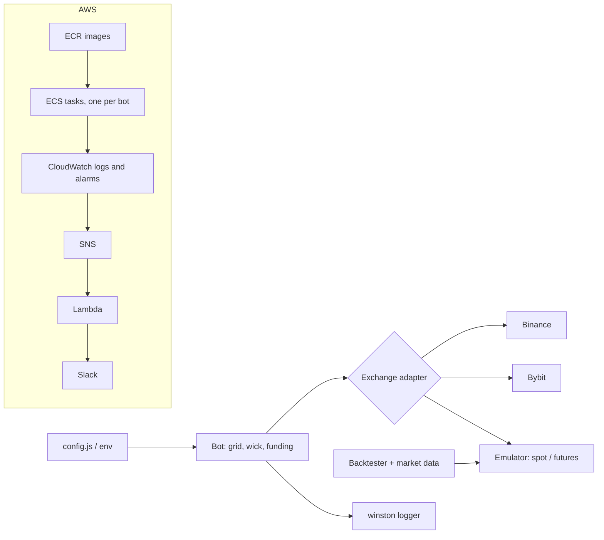

# ccxt-strategy-bots

[](https://github.com/nicolasMazuryk/ccxt-strategy-bots/actions/workflows/ci.yml)
[](LICENSE)

Grid, wick-reversal and funding-arbitrage trading bots built on [ccxt](https://github.com/ccxt/ccxt) and the native
Binance / Bybit SDKs, with an offline backtester. The bots are containerised and deployed to AWS ECS with Terraform.

## The problem

Running several small, rule-based strategies on several exchanges means the same plumbing each time: exchange
adapters, retries and rate-limit handling, order-state tracking, graceful shutdown and deployment. This repo keeps
that plumbing in one place (`src/exchanges`, `src/utils`) so each strategy is a small config plus a bot class, and
lets a strategy run against an emulated exchange (`src/backtester`) before it touches real money.

## Strategies

| Bot | What it does | Notes |
|---|---|---|
| `grid-bot` | Places a ladder of buy/sell limit orders between a lower and an upper price; supports spot, linear futures, hedge mode and an "infinite" grid | [risk calculator](src/grid-bot/grid-risk-calculator) for sizing and liquidation distance |
| `wick-bot` | Finds historical candle wicks at local highs/lows and enters when price sweeps a wick end and reverts, stop at the current candle extreme, 2:1 take-profit | [strategy notes](docs/strategies/wick-bot.md) |
| `funding-bot` | Selects the best upcoming funding-rate opportunities before each funding event and trades around the settlement | [notes](docs/strategies/funding-bot.md) |
| `funding-spot-perp-bot` | Funding-rate capture with a spot leg hedging a perpetual leg | [notes](docs/strategies/funding-spot-perp-bot.md) |

## Architecture



## Stack

Node.js 20+ (ES modules), ccxt, `binance`, `bybit-api`, winston, cron, decimal.js; Docker (arm64); Terraform for
ECS, ECR, IAM, CloudWatch alarms and SNS-to-Slack alerts; ESLint and `node:test`.

## Getting started

```bash
npm ci
cp .env.example .env     # fill in the exchange keys you need (testnet or sub-account keys recommended)
npm test
npm run lint
```

Edit the bot's `config.js` (pair, price range, grid step, leverage), then start it. Credentials are only read from the
environment through `node --env-file=.env`:

```bash
npm run grid-bot
npm run wick-bot
npm run funding-bot
```

Backtesting:

```bash
npm run get-data         # download and filter historical market data into market-data/
npm run backtest         # replay a strategy against the exchange emulator
npm run grid-risk        # grid sizing / liquidation risk calculator
```

In containers (`NODE_ENV=production`) the bots read their whole configuration from environment variables instead
(`PAIR_NAME`, `LOWER_PRICE`, `API_KEY`, ... see `docker/Dockerfile.*` and `.env.example`).

## Deployment

```bash
cd terraform && terraform init && terraform apply   # cluster, repositories, roles, alarms
npm run deploy                                       # builds and pushes the images to ECR
```

Set `TF_VAR_slack_webhook_url` for alert delivery and `AWS_ACCOUNT_ID` for `docker/deploy.sh`. Credentials for the
running tasks are passed through the ECS task definition, never baked into the images.

## Project layout

```
src/
  grid-bot/ wick-bot/ funding-bot/ funding-spot-perp-bot/   strategies (config.js, bot class, run.js)
  exchanges/                                                 Binance, Bybit and emulator adapters
  backtester/                                                engine, market-data tools, metrics
  utils/                                                     retry, logger, graceful shutdown, helpers
docker/       one Dockerfile per grid-bot variant and the ECR deploy script
terraform/    ECS cluster, tasks, IAM, CloudWatch alarms, SNS
aws/          SNS-to-Slack Lambda
docs/         strategy notes and the original to-do lists
test/         node:test unit tests
```

## Design decisions

- **One adapter interface, real and emulated exchanges:** the same bot code runs live and in the backtester.
- **Retries centralised in `utils/retry.js`:** ccxt `OperationFailed` errors back off and retry; everything else fails fast.
- **Config from environment in production:** the same image is reused for different pairs by changing the task definition.
- **One ECS task per bot:** failures and restarts are isolated, and each bot's logs and alarms stay separate.

## Roadmap and limitations

- Experimental: strategies are research code, not production-grade. Several `no-undef` / unreachable-code warnings in the emulator and `volume-traded` scripts are known and left as warnings.
- Test coverage covers the shared utilities only; the bots themselves are exercised through backtests.
- Open items are tracked in [docs/notes/to-do.txt](docs/notes/to-do.txt) and [docs/notes/to-do-grid-bot.txt](docs/notes/to-do-grid-bot.txt).
- Trading carries real financial risk. This is a personal project, provided as-is and not financial advice.

## License

[MIT](LICENSE)
